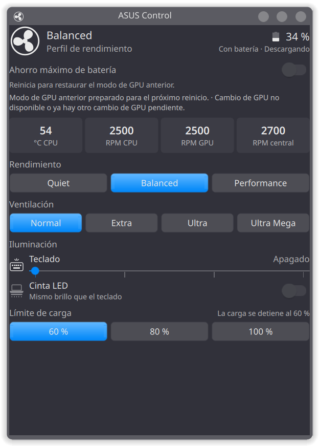
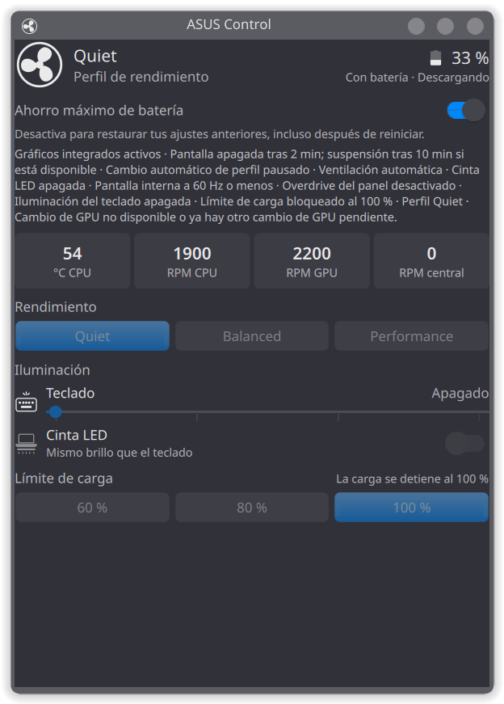

# ASUS Control

<div align="center">
    
</div>

<div align="center">
    
    
    
    
    
    
</div>

Controla tu portátil ASUS ROG desde la bandeja de **KDE Plasma 6**: rendimiento, ventiladores, iluminación y batería. Incluye un interruptor de **ahorro máximo de batería** que guarda tus ajustes y los recupera al apagarlo.

Probado en **ROG Strix G16 G615JH**, Fedora con Wayland y asusd 6.5.0. La interfaz está disponible en español e inglés, según el idioma del sistema.

## Así se ve

<table>
  <tr>
    <th>Controles manuales</th>
    <th>Ahorro activado</th>
  </tr>
  <tr>
    <td></td>
    <td></td>
  </tr>
</table>

Capturas de la versión **0.4.3**. En la izquierda, la GPU espera un reinicio para restaurarse; los demás controles ya están disponibles. La temperatura, las RPM y la batería muestran lecturas del momento.

## Qué puedes ajustar

| Control | Opciones |
|---|---|
| Rendimiento | Quiet, Balanced y Performance |
| Ventilación | Normal, Extra, Ultra y Ultra Mega; disponibles en Balanced |
| Teclado | Cuatro niveles de brillo, incluido apagado |
| Cinta LED | Encendido y apagado; comparte el brillo del teclado |
| Límite de carga | 60, 80 o 100 % |

También muestra la batería real, el estado del cargador, la temperatura de CPU y las RPM de los ventiladores de CPU, GPU y central. El modo **Normal** devuelve la ventilación al control automático de asusd.

Abre el panel haciendo clic en el icono de la bandeja. También puedes buscar **ASUS Control** en el lanzador para abrirlo en una ventana. Los cambios se comprueban con el equipo; si alguno falla, se muestra el error y el valor real.

## Cómo funciona el ahorro

**Al encender el interruptor**, guarda tu configuración y aplica los ajustes compatibles de esta tabla. Los controles manuales quedan bloqueados mientras el ahorro está activo.

| Ajuste | Durante el ahorro |
|---|---|
| Rendimiento | Quiet |
| Límite de carga | 100 %, bloqueado mientras esté activo |
| GPU | Solicita la integrada; el cambio puede requerir reiniciar |
| Ventilación de Balanced y Quiet | Automática |
| Teclado y cinta LED | Apagados; la cinta también en arranque, suspensión y apagado |
| Pantalla interna | 60 Hz o menos, sin cambiar la resolución |
| Overdrive del panel | Desactivado |
| Pantalla inactiva | Se apaga después de 2 minutos |
| Suspensión por inactividad | Después de 10 minutos, si el sistema la admite |

**Al apagar el interruptor**, recupera los ajustes anteriores y vuelve a habilitar los controles manuales. Si únicamente queda la GPU pendiente de reiniciar, puedes cambiar los demás ajustes libremente: tus cambios se conservan después del reinicio. Si vuelves a activar el ahorro, guarda esos nuevos valores para la siguiente restauración.

El ahorro no fija un brillo de pantalla propio; puedes seguir ajustándolo desde KDE. Conserva la configuración de los monitores externos y la acción de la tapa. Durante el ahorro coordina los cambios automáticos de perfil de asusd y de teclado/perfil de KDE; al desactivarlo los restaura.

### Reinicios y cambio de GPU

- El ahorro conserva su estado al cerrar el panel, apagar o reiniciar el equipo. Al iniciar sesión en KDE, el servicio de usuario retoma los ajustes pendientes.
- Un cambio de GPU se prepara para el siguiente reinicio. El panel indica cuándo hace falta; no reinicia ni cierra tu sesión automáticamente.
- Si apagas el ahorro antes de aplicar el cambio de GPU, cancela la solicitud. Si ya cambió a la integrada, recuperar la GPU anterior puede requerir otro reinicio.
- Las salidas de vídeo conectadas a la GPU dedicada pueden dejar de funcionar en modo integrado. Más información en la [documentación de ASUS Linux](https://opengamingcollective.github.io/asusctl/faq/gpu-switching.html).

Los ajustes no compatibles se indican en el panel. La GPU necesita soporte de cambios diferidos y `asus-shutdown.service`; tampoco se reemplaza una solicitud pendiente hecha desde otra herramienta.

### Batería real y límite de carga

El porcentaje del encabezado indica **cuánta batería tienes ahora**. Los botones **60 / 80 / 100 %** indican **hasta dónde debe cargar**.

Por ejemplo, con 34 % de batería y un límite de 100 %, seguirá mostrando 34 % hasta que cargue. Para cargar necesitas conectar el cargador. Con el ahorro apagado eliges el límite; al activarlo pasa a 100 % y al apagarlo recupera el anterior.

### Si un cambio falla

El panel muestra los ajustes pendientes y permite reintentar. El respaldo se conserva hasta completar la restauración. Si está dañado o falla la restauración, los cambios manuales pueden seguir bloqueados hasta resolverlo; una GPU correctamente en cola para reiniciar no los bloquea.

Durante el ahorro, el servicio comprueba periódicamente los ajustes y los vuelve a aplicar si otra herramienta los cambia. Con el ahorro apagado y sin restauraciones pendientes, no lee ni modifica el hardware. El panel sigue actualizando los datos: cada 2 segundos cuando está abierto y solo la batería cada 30 segundos cuando está cerrado.

## Instalación

Necesitas:

- **KDE Plasma 6** y `asusd` en ejecución, incluido en `asusctl`.
- **Python 3.11 o superior** en `/usr/bin/python3`, sin paquetes adicionales.
- **gettext** (`msgfmt`) para instalar las traducciones.
- **PowerDevil**, `kscreen-doctor` y una sesión de usuario con **systemd** para las funciones de ahorro.

Desde la carpeta del proyecto:

```sh
scripts/install.sh
```

Instala para tu usuario, sin sudo, y reinicia Plasma para cargar el applet actualizado. Usa `scripts/install.sh --no-restart` si prefieres reiniciarlo después.

El applet aparece automáticamente en la bandeja. Para actualizarlo, descarga los cambios y ejecuta de nuevo el mismo script; conserva tus preferencias y el respaldo.

Los controles específicos de ventilación y cinta LED están preparados para el G615JH. Otros modelos ROG pueden ofrecer los controles generales, pero no se han probado.

### Cinta LED en el G615JH

Si la cinta no aparece con asusd 6.5.0, hay una definición local del modelo que puedes instalar y revertir con `scripts/lightbar-fix.sh`. Consulta las [instrucciones de la cinta LED](docs/README.md#cinta-led).

## Desinstalación

```sh
scripts/uninstall.sh
```

Primero intenta restaurar tu configuración. Si falla o la GPU necesita un reinicio, conserva la instalación y el respaldo para que puedas terminar y volver a ejecutar el script. Una vez restaurado todo, elimina el applet, el backend, el servicio y los accesos del usuario.

Puedes usar `--no-restart` para evitar reiniciar Plasma. La desinstalación no cambia `/etc/asusd`; si instalaste la corrección de la cinta, reviértela con `sudo scripts/lightbar-fix.sh revert`.

## Uso desde la terminal

```sh
asus-control power-saving on     # activar ahorro
asus-control power-saving off    # restaurar configuración
asus-control power-saving audit  # comprobar los ajustes sin modificarlos
asus-control state               # consultar el estado completo
asus-control battery             # consultar solo la batería
```

El respaldo se guarda en `~/.local/state/asus-control/power-saving.json`, o en `$XDG_STATE_HOME/asus-control/power-saving.json` si defines esa variable. No lo borres mientras haya ajustes pendientes de restaurar.

## Desarrollo y documentación

El applet usa QML y un backend Python sin dependencias externas para acceder a asusd por D-Bus y coordinar los cambios.

```sh
python3 -m venv .venv
.venv/bin/pip install -e '.[dev]'
.venv/bin/ruff check .
.venv/bin/ruff format --check .
.venv/bin/mypy
.venv/bin/pytest
```

Consulta la [documentación técnica](docs/README.md) para la arquitectura, las traducciones y el funcionamiento del backend. Las [pruebas de la versión 0.4.3](docs/validation-0.4.3.md) documentan la corrección de los controles manuales durante la restauración de GPU; las [pruebas de la versión 0.4.2](docs/validation-0.4.2.md) detallan el límite de carga y el cambio diferido de GPU.

## Licencia

[Apache License 2.0](LICENSE).
